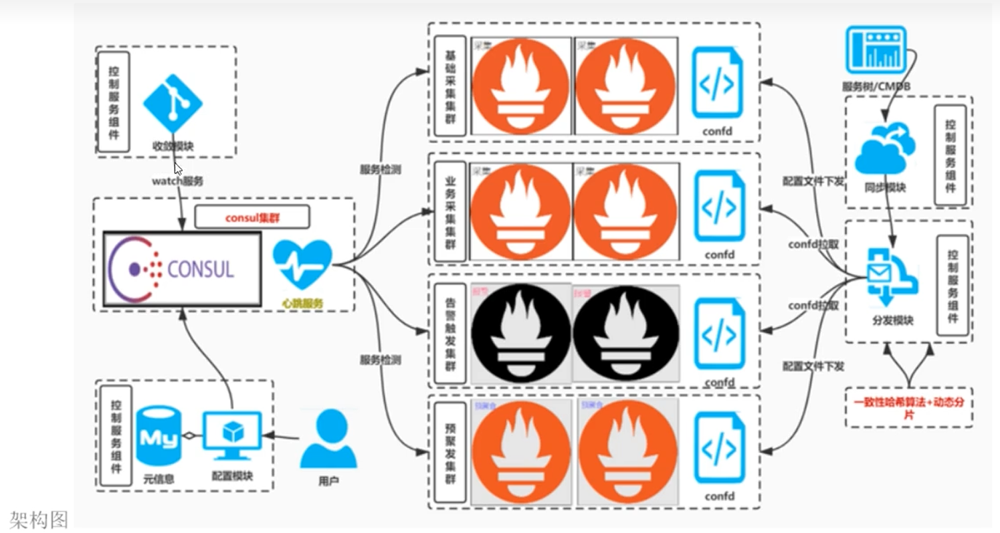

本项目介绍

使用一组采集器注册server到consul中，通过python反射运行定时任务，
通过服务树等外部接口拿到targets池，一致性哈希分发给后端，统一通过fle_sd生效，
consul会对各组采集器实例做探活，当节点变化(宕机或扩容)会触发targets rebalance达到HA目的



架构说明
 - 解析配置文件
 - 同步注册服务到consul中
 - 开启监听watch结果变化的消费者
 - 异步watch各服务
 - 触发/get_service生成哈希环
 - 定时获取目标列根据哈希环生成各个节点的专属文件
 - 通过ansible下发 sd_result文件并reload prometheus 现有方式
 - 配置文件定义方法名称和对应的实例列表，在get_targets中反射定义对应的方法
 - sd本质说明:均能转换成file_sd，只需要给出对应的target结构体就可以

采集器单点/固定分片问题

 - 无论是单点还是固定分片，都不是ha的，只要某一个分片的采集器挂了，那么损失对应的数据
 - 采用consul_watch_service方式，根据返回的健康实例生成一致性哈希环
 - 将target做分片分配给健康的节点采集即可


举例md5sum
```
[root@prome_master_01 prometheus]# md5sum prometheus.yml
b03075ae85405e468a327d285bb1a84f prometheus.yml
```

哈希算法在分布式系统中的问题

 - 在分布式的存储系统中，要将数据存储到具体的节点上
 - 如果我们采用普通的hash算法进行路由，将数据映射到具体的节点上，如key%N，key是数据的key.N是机器节点数
 - 如果有一个机器加入或退出这个集群，则所有的数据映射都无效了，如果是持久化存储则要做数据迁移，如果是分布式缓存，则其他缓存就失效了。
 
 
一致性哈希算法
```
一致性哈希算法在1997年由麻省理工学院提出，是一种特殊的哈希算法，在移除或者添加一个服务器时，能够尽可能小地改变已存在的服务请求与处理请求服务器之间的映射关系。一致性哈希解决了简单哈希算法在分布式哈希表(Distributed Hash Table,IDHT)中存在的动态伸缩等问题。一致性哈希算法优点
```

 - 可扩展性。一致性哈希算法保证了增加或减少服务器时，数据存储的改变最少，相比传统哈希算法大大节省了数
据移动的开销。
 - 更好地适应数据的快速增长。采用一致性哈希算法分布数据，当数据不断增长时，部分虚拟节点中可能包含很多
数据、造成数据在虚拟节点上分布不均衡，此时可以将包含数据多的虚拟节点分裂，这种分裂仅仅是将原有的虚拟节
 - 点一分为二、不需要对全部的数据进行重新哈希和划分。
 - 虚拟节点分裂后，如果物理服务器的负载仍然不均衡，只需在服务器之间调整部分虚拟节点的存储分布。这样可
以随数据的增长而动态的扩展物理服务器的数量，且代价远比传统哈希算法重新分布所有数据要小很多。