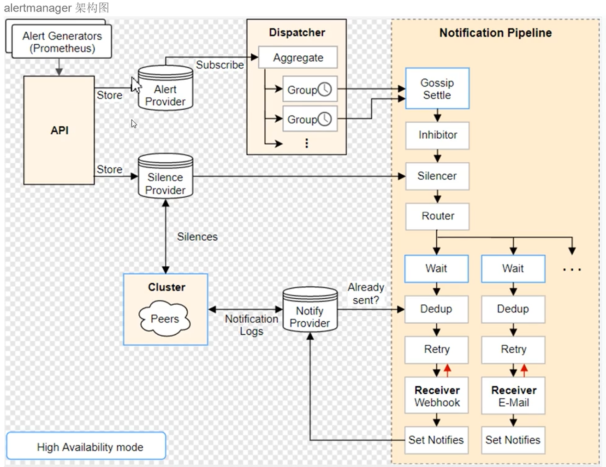

# 告警管理

## 通知通道
 - 邮箱：SMTP
   - 格式：邮件头、subject
   - 内容：html、附件
 - 短信：SMS
   - 状态报告
 - 电话：Phone
   - 语音模板、语音时长、重要告警才会能触发语音
 - 即时通讯：im（钉钉、企业微信、飞书）

## 告警发送
### 考察点
 - 高可用
   - 多厂商对接
   - 消息队列解耦
   - L4/L7
 - etl
   - Extract（抽取）
   - Transform（转换）
   - Load（加载）
 - 业务关注点
   - 告警合并
   - 知否支持@onCall的人
   - im接口限速 一分钟最多发送多少条告警通知
   - 快速看图、能否点击跳转到对应的Grafana链接
   - 带告警图片、富文本、告警内容编排
   - 个人消息、群消息
   - 快速屏蔽按钮 通过交互式卡片实现（静默1小时、24小时、请忽略、处理中、已恢复）
 - 回调联动其他系统
   - 理想流程： 设置告警条件 --》 认为处理几次 --》 处理方案转换为程序处理 --》 回调+通道 --》 回调处理 --》 发送个人通知 --》 告警聚合和总计
   - 和其他系统联动
     - 创建维修工单
     - 自动抓取火焰图
     - 重启服务等待故障自愈

### 告警触发参数
触发条件
 - 连续发生 all
 - 发生次数 happen
 - 数据上报中断 nodata
   - 采集Agent失联对标Prometheus中的 `up==0`
   - Prometheus 的absent函数
 - 与条件（标签要一致）
   - A and B 内存使用率>0.85 && 内存可用量<5G

发送间隔和时间：执行动作
 - 在60分钟内，最多告警2次
 - 高ing发送间隔，重复告警最低5分钟发一次

是否发送回复信息
 - 告警被处理后，是否发送‘告警已恢复’的通知

生效时间
 - 告警通知直在指定的时间段内触发
 - 非告警时间内的告警信息存储

告警升级
 - 告警触发多少次后升级
 - 升级的告警发给谁
 - 避免告警乱升级，无限制的升级到高层领导
 - 升级的告警变成什么通道

告警聚合
 - 避免告警信息爆炸
 - 大的Group下多个实例同时触发
 - 通过增加告警间隔、多条信息合并成一条等方式

告警方式对比
 - [Prometheus告警与夜莺和SkyWalking对比.md](Prometheus%E5%91%8A%E8%AD%A6%E4%B8%8E%E5%A4%9C%E8%8E%BA%E5%92%8CSkyWalking%E5%AF%B9%E6%AF%94.md)
 - [AlertManager 官方文档](https://prometheus.io/docs/alerting/latest/alertmanager/)
 - 

## 告警案例
告警发送程序 [alertSend.go](../../test_mock/push_alert/alert_send/alertSend.go)
告警接受程序 [alertReceiver.go](../../test_mock/push_alert/alert_receiver/alertReceiver.go)

AlertManager告警通知机制
```
告警首次到达
    │
    ▼
新建分组（groupLabels=alertName 的值）→ 等待 group_wait=10s 聚齐
    │
    ▼
发送第 1 次通知 ──────────────→ 你的接收端打印 ✓（你看到的那一次）
    │
    ▼
之后每 30s 推送端又 POST 一批告警到 AM
    │
    ├─ AM 按指纹（labels 的 hash）去重：3 条告警指纹与已存在的一致
    │  → 分组内容【没有变化】→ 不产生新通知
    │
    ▼
只有两种情况会再次通知：
    ① 分组里出现了【新指纹】的告警 → 等待 group_interval=10s 后发送
    ② 距上次通知满 repeat_interval=1h → 重发整组

```
 - 查看分组状态 ```http://ip:port/api/v2/alerts/groups```
 - linux下查看 
 - ``` 
   curl -X GET -H "Content-Type: application/json" \
   'http://192.168.0.210:9093/api/v2/alerts/groups' | jq .
    ```