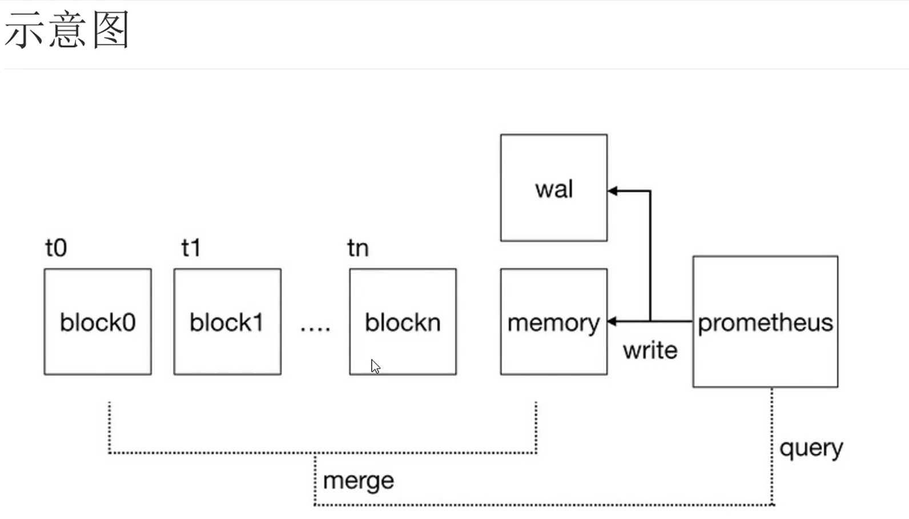

# TSDB-本地存储结构



## 内存数据结构

 - 在Prometheus的内存中使用memSeries结构存储时间序列，一条时间序列对应一个memSeries
 - [head.go](../../tsdb/head.go) tsdb/head.go:2080
 - ```
    type memSeries struct {
        sync.Mutex
        // 这个series的uid
        ref  chunks.HeadSeriesRef
        lset labels.Labels
        meta *metadata.Metadata
        mmappedChunks []*mmappedChunk
    }
   ```
 - 一个MemSeries主要由三部分组成
    - lset: 用于识别这个Series的lable集合。
    - ref: 每接收到一个新的时间序列，Prometheus都会用一个唯一的证书表示它，如果有ref，就可以轻松的找到对应的series
    - memChunks:每一个memChunk是一个时间段内该时间序列所有sample的集合。如果我们想要读取[x,ty](t1<tx<t2,t2<ty<t3)时间范围内该时间序列的数据，只需要对[t1,t3]范围内的两个memChunk的sample数据进行裁剪即可，从而提高了查询的效率。每当采集到新的sample，Prometheus就会用Gorila中类似的算法将它压缩至最新的memChunk中
    - headChunk: 既memChunk在这个Series在这段时间内的数据集合
    ```
      type memChunk struct {
        chunk            chunkenc.Chunk
        minTime, maxTime int64
        prev             *memChunk // Link to the previous element on the list.
    }
      ```

## 哈希表 
 - 基于lable计算一个哈希值，维护一张哈希值与memSeries的映射表。如果产生hash碰撞，则直接使用label进行匹配。
 - 因此Prometheus在内存中维护了两张hash表，无论时使用ref还是label都能很快找到对应的memSeries
 - ```
   type stripeSeries struct {
	    size                    int
	    series                  []map[chunks.HeadSeriesRef]*memSeries // Sharded by ref. A series ref is the value of `size` when the series was being newly added.
	    hashes                  []seriesHashmap                       // Sharded by label hash.
	    locks                   []stripeLock                          // Sharded by ref for series access, by label hash for hashes access.
	    seriesLifecycleCallback SeriesLifecycleCallback
    }
   ```
   
## 锁的颗粒度
 - golang中的map不是并发安全的，而Prometheus中有大量的memSeries的增删操作
 - Prometheus的解决方案是 拆分锁
 - ```
   const (
	    // DefaultStripeSize is the default number of entries to allocate in the stripeSeries hash map.
	    DefaultStripeSize = 1 << 14
    )
   
   type stripeSeries struct {
	    size                    int
	    series                  []map[chunks.HeadSeriesRef]*memSeries // Sharded by ref. A series ref is the value of `size` when the series was being newly added.
	    hashes                  []seriesHashmap                       // Sharded by label hash.
	    locks                   []stripeLock                          // Sharded by ref for series access, by label hash for hashes access.
	    seriesLifecycleCallback SeriesLifecycleCallback
    }

    type stripeLock struct {
        sync.RWMutex
        // Padding to avoid multiple locks being on the same cache line.
        _ [40]byte
    }
   ```
 - 初始化head的时候生成16384个小哈希表，如果想根据ref找到memseries，只需要把ref对16384取模找到对应的series[x]，只需要lock[x]，从而大大降低了读写memseries时对锁的抢占造成的消耗，提升读写吞吐量。


## 内存和硬盘之间的纽带 WAL
 - 文档地址 [wal.md](../../tsdb/docs/format/wal.md)
 - WAL目录中包含了多个连续编号且大小为128M的文件。Prometheus称这样的文件为Segment，其中存放的就是对内存中series、sample数据的备份
 - 另外还包含一个以checkpoint为前缀的子目录，由于内存中的时序数据，经常会做持久化处理。 WAL中的数据也将因此出现冗余
 - 所以每次在对内存数据进行持久化之后，Prometheus都会对部分编号靠后的Segment进行清理。但是我们并没有办法做到恰好将已经持久化的数据从Segment中剔除，也就是说被删除的Segment中部分的数据依然可能是有用的。所以在清理Segment时，我们会将肯定无效的数据删除，剩下的数据就存放在checkpoint中。而在Prometheus重启时，应该首先加载checkpoint中的内容，再按序加载各个Segment的内容。
 - 最后，series和samples以Record的形式被批量写入Segment文件中，默认当Segment超过128M时，会创建新的Segment文件。
 - 若Prometheus因为各种原因崩溃了，WAL里的各个Segment以及checkpoint里的内容就是在崩溃时刻Prometheus内存的映像。Prometheus在重启时只要加载WAL中的内容就能完全"恢复现场"


## 磁盘数据结构
```
data/
├── queries.active                              # 活跃查询追踪文件（mmap，约 19.5 KB）
├── 01M74VQNNE3J4BZW68WHBS8BPH/                 # ★ 已持久化块（ULID 命名，时间递增）各个block，数量是固定的，回通过压缩算法压实（Compact）
│   ├── meta.json                               # 块元数据（0.3 KB）代表该block的元数据
│   ├── index                                   # 倒排索引（75.2 KB）代表block内的索引数据
│   ├── tombstones                              # 删除墓碑（目前为空，0 KB）
│   └── chunks/                                 # 保存该block内所有 时序数据
│       └── 000001                              # 样本 chunk 段文件（21.0 KB）
├── 01M75Q5NCEQP6G4YSJGW1PP8VW/                 # 另一个块（同结构，14.0 KB chunks） 
├── chunks_head/                                # ★ 当前内存块的 mmap chunk 段目录（本实例为空）
├── lock                                        # 锁
└── wal/                                        # ★ 预写日志（最新数据在这里）
    ├── 00000021                                # WAL 段文件（32.0 KB，段大小默认 128MB）
    ├── 00000022                                # 同上
    ├── 00000023                                # 当前正在写的段（最大编号）
    └── checkpoint.00000020/                    # ★ 截断检查点（含 00000000 数据文件）
        └── 00000000                            # 依然可能是有用的数据
```

## Chunks
 - 块文件格式，文档地址[chunks.md](../../tsdb/docs/format/chunks.md) 
 - 每段文件最大为512Mb

## HeadChunks
 - 文档地址 [head_chunks.md](../../tsdb/docs/format/head_chunks.md)

## Tombstones
 - 文档地址 [tombstones.md](../../tsdb/docs/format/tombstones.md)
 - prometheus删除数据 /admin/tsdb/delete_series
 - tombstones用于存储对于series的删除记录。如何删除了某个时间序列，Prometheus并不会立即对它进行清理，而是会在tombstones做一次记录，等到下一次block压缩合并的时候统一清理。

## 对block进行定时压实Compact
- 删除标记。
- Compaction 主要操作包括合并block、删除过期数据、重构Chunk数据。
- 其中合并多个block称为更大的block，可以有效的减少block的个数。
- 当查询覆盖的时间范围较长时，避免需要合并很多block的查询结果。
- 为提高删除的效率，删除时序数据时，会记录删除的位置，只有当block所有的数据都需要删除的时候，才将block整个目录删除，因此block合并的大小也需进行限制。